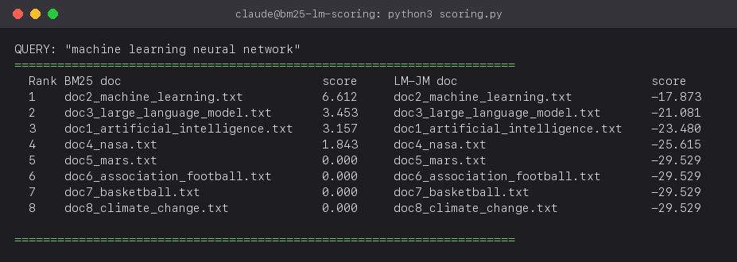

# bm25-lm-scoring

Document ranking scoring functions -- Okapi BM25 and a Language Model with
Jelinek-Mercer smoothing (LM-JM) -- implemented from scratch in Python.

- 8 public documents (Wikipedia extracts) in `docs/`, same corpus used in
  the Week 3 vector-space-model assignment.
- `scoring.py` -- corpus loading, tokenizer, BM25, LM-JM, and a ranking
  helper, from scratch (no `rank_bm25` / IR scoring library used).
- Full write-up, APA report, and result screenshots: [`REPORT.docx`](REPORT.docx).

## Quick start

```bash
pip install -r requirements.txt
python3 scoring.py
```

## Result preview

Query `"machine learning neural network"` ranked by both functions:


