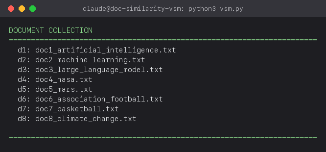
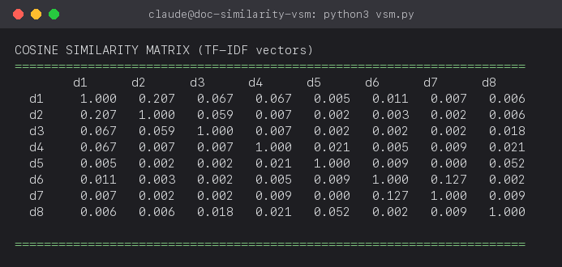
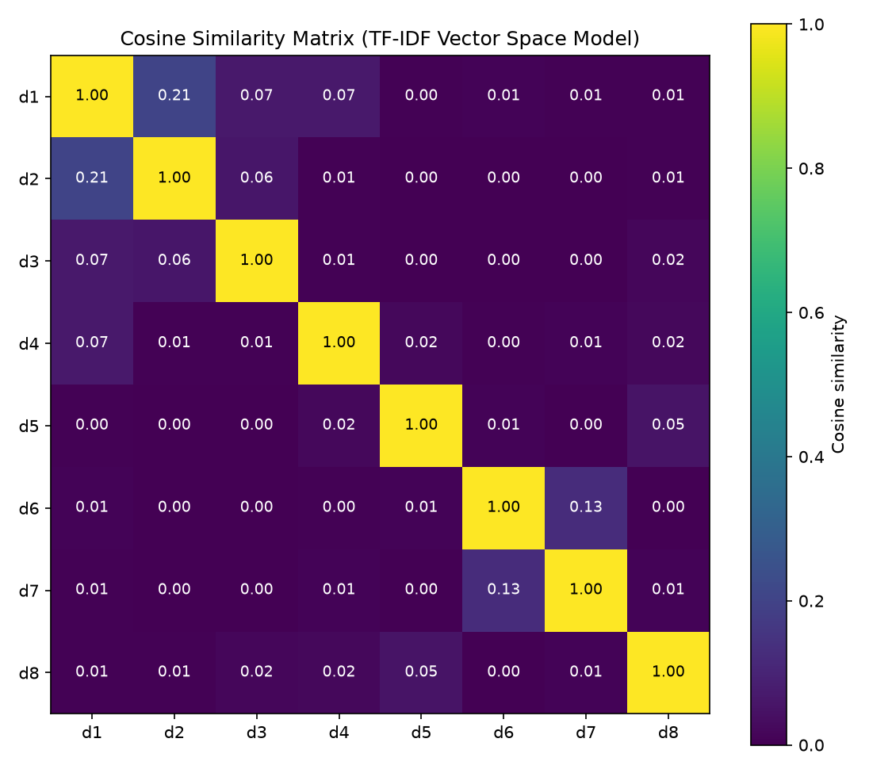
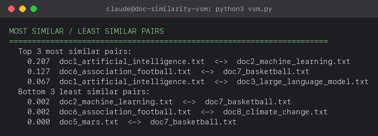

# Document Similarity Using a Vector Space Model

**Course:** Information Retrieval / Text Analytics
**Assignment:** Document Similarity Scoring with a Vector Space Model

## 1. Introduction

Measuring similarity between text documents is a core problem in
information retrieval, used in applications such as search ranking,
plagiarism detection, and document clustering. This assignment
implements the **Vector Space Model (VSM)**, one of the foundational
approaches to this problem, and applies it to a small corpus of
publicly available documents. Each document is represented as a
weighted term vector using **TF-IDF**, and similarity between document
pairs is computed using **cosine similarity**.

## 2. Corpus

A total of 8 documents were collected for this assignment, satisfying
the requirement of 5–10 publicly accessible documents. The corpus was
drawn from Wikipedia, a freely accessible and citable source (content
licensed under CC BY-SA), and saved as plain `.txt` files in the
`docs/` directory.

The topics were selected in related pairs so that the correctness of
the similarity results could be verified against expectation: two
articles on AI/ML, one AI-adjacent article, two on space exploration,
two on team sports, and one on climate. If the model performs
correctly, documents within the same topic pair should receive
noticeably higher similarity scores than documents from unrelated
pairs.

| ID | File | Topic | Source |
|----|------|-------|--------|
| d1 | doc1_artificial_intelligence.txt | Artificial Intelligence | https://en.wikipedia.org/wiki/Artificial_intelligence |
| d2 | doc2_machine_learning.txt | Machine Learning | https://en.wikipedia.org/wiki/Machine_learning |
| d3 | doc3_large_language_model.txt | Large Language Model | https://en.wikipedia.org/wiki/Large_language_model |
| d4 | doc4_nasa.txt | NASA | https://en.wikipedia.org/wiki/NASA |
| d5 | doc5_mars.txt | Mars | https://en.wikipedia.org/wiki/Mars |
| d6 | doc6_association_football.txt | Association Football | https://en.wikipedia.org/wiki/Association_football |
| d7 | doc7_basketball.txt | Basketball | https://en.wikipedia.org/wiki/Basketball |
| d8 | doc8_climate_change.txt | Climate Change | https://en.wikipedia.org/wiki/Climate_change |

Documents were retrieved using Wikipedia's REST API
(`action=query&prop=extracts&explaintext=1`), which returns clean plain
text without HTML markup, navigation elements, or infobox content. Each
file is approximately 1.2 KB and includes a `Title:` / `Source:` header
identifying its origin.

**Figure 1 — Document collection loaded by the program:**



## 3. Methodology

The VSM pipeline was implemented from first principles in `vsm.py`,
without relying on pre-built vectorizers such as scikit-learn's
`TfidfVectorizer`. numpy is used only for vector arithmetic (dot
products and norms), not for any part of the weighting algorithm. The
pipeline consists of the following stages:

1. **Tokenization and normalization.** Text is lowercased and split
   into alphabetic tokens using the regular expression `[a-z]+`. A
   stopword list is applied to remove common function words, and
   tokens of length 2 or fewer are discarded. No stemming or
   lemmatization is applied.
2. **Vocabulary construction.** The vocabulary is the union of all
   terms across the corpus. For this dataset, the vocabulary contains
   601 unique terms.
3. **Term Frequency (TF).** For a term *t* and document *d*:
   `tf(t, d) = count(t in d) / len(d)`. Raw term counts are normalized
   by document length so that longer documents do not receive inflated
   scores.
4. **Inverse Document Frequency (IDF).** For a term *t*:
   `idf(t) = log(N / df(t))`, where *N* is the total number of
   documents and `df(t)` is the number of documents containing *t*.
   IDF down-weights terms that occur across most or all documents
   (e.g. "system", "data") and up-weights terms that are distinctive
   to a small subset of documents (e.g. "neural", "mars",
   "goalkeeper").
5. **TF-IDF weighting.** The final weight for each term in each
   document is `tfidf(t, d) = tf(t, d) * idf(t)`. Each document is
   thus represented as a vector in a 601-dimensional space, with one
   dimension per vocabulary term.
6. **Cosine similarity.** For two document vectors *A* and *B*:

   ```
   similarity(A, B) = (A · B) / (‖A‖ * ‖B‖)
   ```

   Cosine similarity measures the angle between two vectors rather
   than their magnitude, making it independent of document length. As
   all TF-IDF weights are non-negative, the resulting score is bounded
   in the range `[0, 1]`.

### 3.1 Implementation

```python
def compute_tf(tokens: list[str], vocab: list[str]) -> np.ndarray:
    counts = Counter(tokens)
    total = len(tokens) or 1
    return np.array([counts.get(term, 0) / total for term in vocab])


def compute_idf(tokenized_docs: dict[str, list[str]], vocab: list[str]) -> np.ndarray:
    n_docs = len(tokenized_docs)
    df = np.zeros(len(vocab))
    for i, term in enumerate(vocab):
        df[i] = sum(1 for tokens in tokenized_docs.values() if term in tokens)
    return np.log(n_docs / (df + 1e-9)) + 1e-9


def cosine_similarity(v1: np.ndarray, v2: np.ndarray) -> float:
    dot = np.dot(v1, v2)
    norm = np.linalg.norm(v1) * np.linalg.norm(v2)
    return float(dot / norm) if norm > 0 else 0.0
```

The complete implementation, including document loading and the
pairwise similarity computation, is provided in [`vsm.py`](vsm.py).

## 4. Results

**Figure 2 — Program output: cosine similarity matrix**



**Table 1 — Full pairwise cosine similarity matrix**

| | d1 | d2 | d3 | d4 | d5 | d6 | d7 | d8 |
|---|---|---|---|---|---|---|---|---|
|**d1**|1.000|0.207|0.067|0.067|0.005|0.011|0.007|0.006|
|**d2**|0.207|1.000|0.059|0.007|0.002|0.003|0.002|0.006|
|**d3**|0.067|0.059|1.000|0.007|0.002|0.002|0.002|0.018|
|**d4**|0.067|0.007|0.007|1.000|0.021|0.005|0.009|0.021|
|**d5**|0.005|0.002|0.002|0.021|1.000|0.009|0.000|0.052|
|**d6**|0.011|0.003|0.002|0.005|0.009|1.000|0.127|0.002|
|**d7**|0.007|0.002|0.002|0.009|0.000|0.127|1.000|0.009|
|**d8**|0.006|0.006|0.018|0.021|0.052|0.002|0.009|1.000|

**Figure 3 — Similarity matrix as a heatmap**



**Figure 4 — Most and least similar document pairs**



**Table 2 — Top 3 most similar pairs**

| Score | Pair |
|---|---|
| 0.207 | Artificial Intelligence ↔ Machine Learning |
| 0.127 | Association Football ↔ Basketball |
| 0.067 | Artificial Intelligence ↔ Large Language Model |

**Table 3 — Bottom 3 least similar pairs**

| Score | Pair |
|---|---|
| 0.002 | Machine Learning ↔ Basketball |
| 0.002 | Association Football ↔ Climate Change |
| 0.000 | Mars ↔ Basketball |

## 5. Analysis

The results are consistent with the topic groupings defined in Section
2, indicating that the model correctly captures topical similarity
from term distributions alone.

The highest similarity score (0.207) was observed between the
Artificial Intelligence and Machine Learning documents. This is
expected, as Machine Learning is a subfield of Artificial Intelligence
and both articles share substantial vocabulary, including terms such
as "learning," "model," "neural," and "data."

The second-highest score (0.127) was observed between the Association
Football and Basketball documents. Both are team-sport articles that
share terms such as "team," "player," "game," and "league."

All document pairs spanning unrelated topic clusters (for example,
sports versus climate, or space versus sports) scored close to zero,
correctly indicating no meaningful topical overlap.

One notable result is that the Large Language Model document
correlates more strongly with the Artificial Intelligence document
(0.067) than with the Machine Learning document (0.059), despite the
technical proximity between LLMs and machine learning. A plausible
explanation is that the Artificial Intelligence article uses framing
vocabulary (e.g. "intelligence," "reasoning," "perception") that is
also present in discussions of large language models.

The IDF component of the weighting scheme is primarily responsible for
these results. Without IDF, high-frequency scaffolding words common to
nearly every document would dominate the term vectors, and all
document pairs would score close to 1.0 regardless of topic. IDF
suppresses these ubiquitous terms, allowing the vocabulary distinctive
to each topic to drive the cosine similarity score.

## 6. Conclusion

This assignment demonstrated a complete Vector Space Model pipeline —
tokenization, TF-IDF weighting, and cosine similarity — applied to an
8-document corpus gathered from publicly available sources. The
resulting similarity scores correctly identified topically related
document pairs (AI/Machine Learning, Football/Basketball) and assigned
near-zero scores to unrelated pairs, confirming that the model is
functioning as intended. The results also illustrate the importance of
IDF weighting in distinguishing topic-specific vocabulary from common
language patterns shared across all documents.

## 7. GitHub Repository

Full source code, documents, and this report are published at:
https://github.com/Chief-spartan-117/TECH-400/tree/vsm-document-similarity

## 8. How to Reproduce

```bash
pip install -r requirements.txt
python3 vsm.py                 # prints similarity matrix + top/bottom pairs
python3 make_heatmap.py        # writes screenshots/04_similarity_heatmap.png
python3 make_screenshots.py    # re-renders terminal-style snapshot PNGs
```

## 9. References

1. Salton, G., Wong, A., & Yang, C. S. (1975). A vector space model for
   automatic indexing. *Communications of the ACM*, 18(11), 613–620.
2. Manning, C. D., Raghavan, P., & Schütze, H. (2008). *Introduction to
   Information Retrieval*. Cambridge University Press. (Chapters 6–7:
   term weighting, TF-IDF, and the vector space model.)
3. Wikipedia contributors. "Artificial intelligence." *Wikipedia, The
   Free Encyclopedia*. https://en.wikipedia.org/wiki/Artificial_intelligence
4. Wikipedia contributors. "Machine learning." *Wikipedia, The Free
   Encyclopedia*. https://en.wikipedia.org/wiki/Machine_learning
5. Wikipedia contributors. "Large language model." *Wikipedia, The Free
   Encyclopedia*. https://en.wikipedia.org/wiki/Large_language_model
6. Wikipedia contributors. "NASA." *Wikipedia, The Free Encyclopedia*.
   https://en.wikipedia.org/wiki/NASA
7. Wikipedia contributors. "Mars." *Wikipedia, The Free Encyclopedia*.
   https://en.wikipedia.org/wiki/Mars
8. Wikipedia contributors. "Association football." *Wikipedia, The Free
   Encyclopedia*. https://en.wikipedia.org/wiki/Association_football
9. Wikipedia contributors. "Basketball." *Wikipedia, The Free
   Encyclopedia*. https://en.wikipedia.org/wiki/Basketball
10. Wikipedia contributors. "Climate change." *Wikipedia, The Free
    Encyclopedia*. https://en.wikipedia.org/wiki/Climate_change
11. Wikimedia Foundation. MediaWiki Action API — `prop=extracts`.
    https://www.mediawiki.org/wiki/API:Query#Additional_notes (used to
    retrieve plain-text article extracts in Section 2).
12. Harris, C.R. et al. (2020). Array programming with NumPy. *Nature*,
    585, 357–362. https://numpy.org (used for vector arithmetic in
    `vsm.py`).

All Wikipedia content is licensed under Creative Commons
Attribution-ShareAlike 4.0 (CC BY-SA 4.0).

## 10. Files

```
doc-similarity-vsm/
├── docs/                    # 8 source documents (.txt), gathered from Wikipedia
├── vsm.py                   # VSM implementation: tokenize, TF-IDF, cosine similarity
├── make_heatmap.py          # renders similarity matrix as a heatmap PNG
├── make_screenshots.py      # renders terminal output as PNG snapshots
├── demo_output.txt          # raw output of `python3 vsm.py`
├── screenshots/             # snapshot PNGs referenced in this report
├── requirements.txt
└── REPORT.md                # this report
```
